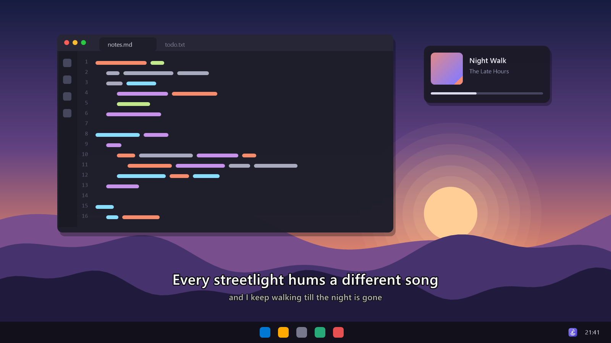
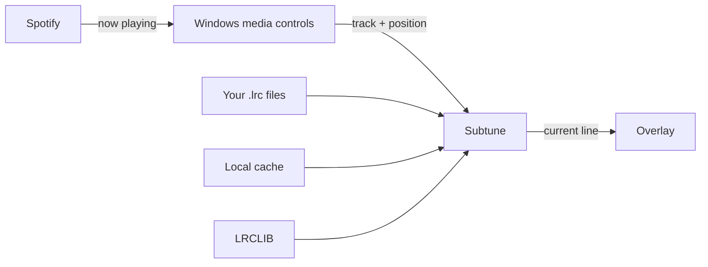

<p align="center">
  <picture>
    <source media="(prefers-color-scheme: dark)" srcset="assets/wordmark-dark.svg">
    
  </picture>
</p>

<p align="center">
  <strong>Lyrics for whatever's playing, right where you're looking.</strong><br>
  Subtune follows Spotify and shows the current line as a quiet subtitle on top of your screen,<br>
  so you can sing along without switching windows.
</p>

<p align="center">
  <a href="https://github.com/vvanouytsel/subtune/releases/latest/download/Subtune.exe"></a>
</p>

<p align="center">
  
  
  
</p>

<p align="center">
  
</p>

## Why Subtune

<table>
  <tr>
    <td width="33%" valign="top">
      <h3>Nothing to sign in to</h3>
      <p>Subtune reads what's playing from Windows itself, the same info the volume flyout shows. Your Spotify account stays out of it.</p>
    </td>
    <td width="33%" valign="top">
      <h3>Stays out of your way</h3>
      <p>The overlay is transparent and click-through. Your mouse keeps going to whatever is underneath, and the lyrics fade out when you pause.</p>
    </td>
    <td width="33%" valign="top">
      <h3>On time</h3>
      <p>Time-synced lyrics from <a href="https://lrclib.net">LRCLIB</a>, switching line by line as the song plays. A hotkey nudges the timing if a version runs early or late.</p>
    </td>
  </tr>
  <tr>
    <td width="33%" valign="top">
      <h3>Your size, your spot</h3>
      <p>Drag it anywhere and pull the edges to resize. The text scales with the box and wraps long lines.</p>
    </td>
    <td width="33%" valign="top">
      <h3>Featherweight</h3>
      <p>Event-driven and asleep between lines: about 0.3% of one CPU core and ~17&nbsp;MB of memory while it's showing lyrics.</p>
    </td>
    <td width="33%" valign="top">
      <h3>Fill the gaps</h3>
      <p>Song not in the database? Drop your own <code>.lrc</code> file in the lyrics folder and Subtune uses it from then on.</p>
    </td>
  </tr>
</table>

## Get started

1. **Download** [`Subtune.exe`](https://github.com/vvanouytsel/subtune/releases/latest/download/Subtune.exe) from the latest release. It's a single file with nothing to install.
2. **Put it somewhere permanent** and double-click it. For a desktop icon: right-click it → *Show more options* → *Send to* → *Desktop (create shortcut)*.
3. **Play something on Spotify.** The current line appears near the bottom of your screen.

Subtune lives in the system tray. Double-clicking it again while it's running just brings the lyrics back.

> [!NOTE]
> The exe isn't code-signed, so Windows SmartScreen may warn the first time. Choose *More info* → *Run anyway*.

## Controls

| Hotkey | What it does |
|---|---|
| <kbd>Ctrl</kbd> <kbd>Alt</kbd> <kbd>L</kbd> | Show or hide the lyrics |
| <kbd>Ctrl</kbd> <kbd>Alt</kbd> <kbd>M</kbd> | Move and resize: drag the box, pull its edges, press again to lock |
| <kbd>Ctrl</kbd> <kbd>Alt</kbd> <kbd>→</kbd> | Lyrics sooner (+0.25 s) |
| <kbd>Ctrl</kbd> <kbd>Alt</kbd> <kbd>←</kbd> | Lyrics later (−0.25 s) |

If another app already owns a combination, Subtune adds <kbd>Shift</kbd> to it. The tray menu shows the
combination you got, and also has *Show next line*, *Open my lyrics folder*, *Start with Windows* and *Quit*.
Left-click the tray icon to show or hide the lyrics.

## Good to know

- **Full-screen apps.** Subtune shows on top of normal, maximized and borderless windows. Apps that use
  *exclusive* fullscreen take over the whole display, so switch those to borderless or windowed mode.
- **Lyrics coverage.** LRCLIB is community-run and has most popular music, but smaller releases can be
  missing. Subtune tells you when it can't find a song. Add your own file named exactly
  `<Artist> - <Title>.lrc` to the lyrics folder (tray menu → *Open my lyrics folder*).
- **Privacy.** The only thing that leaves your PC is the artist, title, album and length of the song,
  sent to LRCLIB to look up its lyrics. Results are cached, so each song is looked up once.

## How it works



Windows tells Subtune when the track, play state or position changes. Subtune finds the lyrics, then sets
a single timer for the moment the next line starts, redrawing the overlay only when the line changes.

## Settings and files

| What | Where |
|---|---|
| Settings | `%APPDATA%\Subtune\settings.json` |
| Your `.lrc` files | `%APPDATA%\Subtune\lyrics\` |
| Lyrics cache and log | `%LOCALAPPDATA%\Subtune\` |

Set `"AnyPlayer": true` in the settings to follow other media apps when Spotify isn't running.

## Build from source

Needs the [.NET 10 SDK](https://dotnet.microsoft.com/download) on Windows 10 1809 or later.

```bash
dotnet run --project src/Subtune
```

Try it without Spotify. This fake-plays a song, optionally starting N seconds in:

```bash
dotnet run --project src/Subtune -- --demo 26
```

Build, install to `%LOCALAPPDATA%\Programs\Subtune` and add desktop and Start menu shortcuts:

```bash
powershell -ExecutionPolicy Bypass -File install.ps1
```

## Releases

Commits follow [Conventional Commits](https://www.conventionalcommits.org). The
[Release workflow](.github/workflows/release.yml) turns them into a [semver](https://semver.org) version.
Run it from the Actions tab with **auto** and it picks the next version from the commits since the last
tag: `fix:` bumps the patch, `feat:` the minor, and `!` or `BREAKING CHANGE:` the major. It then builds a
self-contained `Subtune.exe` and publishes a GitHub release with grouped release notes and a SHA-256
checksum. Pushing a tag such as `v1.2.0` releases that exact version instead.

<p align="center"><sub>Lyrics provided by <a href="https://lrclib.net">LRCLIB</a>. Subtune isn't affiliated with Spotify.</sub></p>
